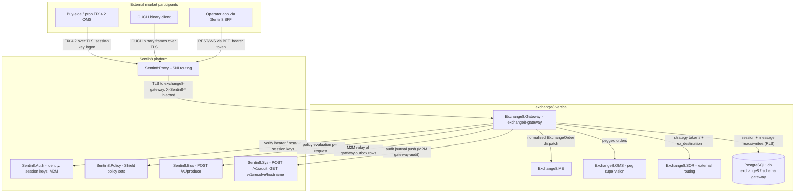

# Exchange8:Gateway

## 1. Summary

Exchange8:Gateway is the market-access front end of the exchange8 vertical: it
terminates FIX 4.2 client sessions (with an OUCH binary-codec subset and
BFF-proxied REST/WebSocket order shapes), runs the FIX session protocol
(logon, sequence integrity, resends, heartbeat, logout) as a pure state
machine, and converts downstream matching-engine lifecycle events into FIX
ExecutionReports. Every client-facing order goes out through a normalized
order model (`ExchangeOrder`) that routes by order type - limit/market to
Exchange8:ME, pegged to the Exchange8:OMS peg supervisor, strategy-with-destination to
Exchange8:SOR.

## 2. Motivation

- Give buy-side and prop desks a standard FIX 4.2 order-entry surface with
  complete session semantics: sequence-gap detection, resend from a durable
  message store, `PossDup` handling, heartbeat negotiation, and reset
  semantics identical across gateway instances.
- Let non-FIX users (operator app, crypto venues) place orders through the
  same gateway via the BFF REST/WebSocket surface with the same validation
  and routing decision, so order behavior does not depend on the wire
  protocol used.
- Keep client session state durable in PostgreSQL (RLS-scoped) so a gateway
  restart does not lose sequence counters or the resend window.
- Terminate vendor/"on-behalf-of" submissions where the beneficiary firm
  owns the risk/STP attribution while the vendor session receives reports.
- Guarantee disconnect safety: every live order of a dropped connection can
  be cancelled (`cancel_on_disconnect`).
- Keep secrets out of the database: FIX logon credentials are Sentin8-issued
  session keys verified by a constant-time comparison against key
  references resolved from the secret store.

## 3. Architecture & High-Level Design

Exchange8:Gateway is a Rust axum binary built on the shared `sentin8::shell`
platform crate (Sentin8 Shell): service self-registration
(`--print-registration`), the capped PostgreSQL pool, the health endpoint,
and graceful drain are provided by the shell; the service adds its HTTP
routes and hosts the FIX/OUCH/REST protocol cores. HTTP requests run the
standard 8-step authorization pipeline (bearer verify → tenant resolve →
feature gate → Shield authorize → RLS context → execute → audit).

The FIX and OUCH protocol layers are **pure** module logic: the session
state machine acts on an abstract message transport, and the shell supplies
sockets/streams plus the persistence callbacks
(`gateway.fix_session_state`, `gateway.fix_message`). Durable writes follow
the platform outbox-first pattern (domain write + `gateway.outbox` row in
the same transaction; the shell relay pushes to Sentin8:Bus).

Key responsibilities by module:

- `session.rs` - the FIX 4.2 protocol state machine: logon
  negotiation/reset, in-order delivery, gap queue + ResendRequest, low-seq
  teardown, `PossDup` re-delivery drop, resend serving (GapFill spans for
  admin traffic, `PossDupFlag=43=Y` for app traffic), TestRequest handling.
- `submission.rs` - the submission pipeline primitives: order-shape
  validation and route decision (MatchingEngine / OmsPeg / Sor), the
  monotonic order-id assigner leased from the platform sequence
  facility, the cancel-on-disconnect
  registry, on-behalf-of attribution, and FIX 5.0 BeginString negotiation.
- `ouch.rs` - the OUCH binary codec for the exchange8 subset (Enter /
  Replace / Cancel in; Ordered / Accepted / Rejected / Canceled / Executed /
  CanceledDueToCross out) with fixed little-endian, space-padded layouts.
- `exec_report.rs` - ME lifecycle events → FIX ExecutionReport field
  selection (ExecType 150 / OrdStatus 39 / LeavesQty 151 / CumQty 14 /
  LastQty 32 / LastPx 31).
- `rest_api.rs` - logon key verification (constant-time compare against
  `secret://exchange8/fix/{comp}` key references) and the BFF REST/WS order
  request/response shapes.
- `handlers.rs` - the RLS-scoped connection-management HTTP API
  (list sessions, read sequence state, admin sequence reset) and the
  admin/RFW surface (page definitions `sessions`/`messages`, data
  endpoints, the admin stop action, the Cron proxy-back purge target).
- `events.rs` - the typed event envelopes (vocabulary constants + identity
  block + builders) and the audit-journal writers: every lifecycle/order
  write pairs its outbox row in the same transaction (outbox-first), and
  admin mutations journal audit rows whose pusher the shell provides.
- `runtime_wiring.rs` - the binary's runtime wiring: the FIX + OUCH TLS
  acceptor tasks (one connection task per accepted client), the logon key
  gate arm (`SessionKeyRegistry` from the secret-reference chain), the
  session-supervisor registry (admin stop delivery), the submission
  dispatch, and the retention executor (schedule registration + batched
  per-env purge).

## 4. Key Traits and Data Structures

- `FixSession` - the per-connection FIX 4.2 state machine
  (`AwaitingLogon → Established → LoggingOut → Disconnected`). Carries the
  CompID pair, the persisted in/out sequence counters, the clamped
  heartbeat interval, the inbound gap queue, and a pending resend range.
  Produces `SessionAction`s (`Send`, `Disconnect`) plus the app messages
  now deliverable to the business layer.
- `SessionKeyRegistry` / `LogonDecision` - the FIX logon credentials
  verifier: CompID → Sentin8-issued session key, constant-time comparison,
  three outcomes (Accepted / UnknownCompId / BadKey) with no factor
  disclosure.
- `Route` / `SubmitReject` - the routing decision over a normalized
  `ExchangeOrder` (direct ME, OMS peg, SOR external) and the pre-execution
  rejection reasons.
- `OrderIdAssigner` - a leased-block counter: the shell leases ranges from
  the platform sequence facility and the assigner hands out
  monotonic `gw_order_id`s; exhaustion signals a refill.
- `CancelOnDisconnect` - the live-order registry per connection; on
  disconnect it yields the full set of live order ids to cancel.
- `OnBehalfOf` / `Attribution` - vendor/beneficiary pair resolution: the
  beneficiary owns STP/risk attribution, the vendor session is the report
  target.
- `FixVersion` - BeginString (tag 8) negotiation between FIX 4.2 and FIX
  5.0 / FIXT 1.1 (with the 5.0 `NextExpectedMsgSeqNum (789)` capability
  flag).
- `ExecReport` - the converted report field set and its FIX body fragment
  serializer (tag order, SOH-separated).
- `RestOrderRequest` / `CryptoRestOrder` / `CryptoWsOrderEvent` - the BFF
  REST/WebSocket order shapes with their domain validation
  (crypto quantities/prices are integer-scaled at ×10⁸).
- OUCH message structs (`EnterOrder`, `ReplaceOrder`, `CancelOrder`,
  `OuchOutbound`) - fixed-layout codec with byte-level side/visibility,
  TIF, and capacity mapping to the normalized order model.

## 5. Rationale, Trade-offs, and Alternatives

- **Pattern choices.** The FIX session layer is a pure state machine over
  an abstract transport - the module knows nothing about tokio or sockets -
  so sequence semantics are exhaustively unit-testable without network or
  database, and the transport shell can evolve independently. The same
  pattern applies to the OUCH codec and exec-report conversion.
- **Sequence state in PostgreSQL, not in memory.** Counters and the resend
  message store live in `gateway.fix_session_state` / `gateway.fix_message`
  (RLS-forced) instead of process-local files or mmap images: sessions
  survive restarts and instance failover, and sequence state is auditable
  per connection. The trade-off is one indexed read/write per message
  versus instant in-memory access - acceptable at order-entry rates and
  required for durability.
- **Gap-fill-only resend.** Resend serving collapses admin (non-app)
  messages into `SeqReset-GapFill` spans and replays app messages with
  `PossDupFlag=43=Y`. A purged store window gap-fills forward and stops -
  a documented limitation traded for bounded store retention rather than an
  unbounded negative-ack model.
- **Dispatching.** Resend serving takes a store-lookup callback rather than
  a database handle: the state machine stays transport/persistence-free and
  the shell owns pool, RLS context, and retention policy.
- **Concurrency.** Each FIX connection is owned by one task (sequence
  counters are per-session, never shared); shell-level workers (bus
  consumers, session supervisors, purge jobs) are in-process tokio tasks
  via the platform helper so a burst of sessions cannot exhaust
  PostgreSQL connections.
- **Rejected alternatives.**
  - CompID-only logon trust - rejected: logon credentials must be
    Sentin8-issued session keys verified by constant-time comparison; the
    connection row alone is not an authenticator.
  - Plaintext key storage in the connection table - rejected; keys are
    referenced as `secret://exchange8/fix/{comp}` and resolved out-of-band.
  - Session state in mmap/OS files - rejected in favor of RLS-scoped
    database rows (portable across instances, auditable, purgeable).
  - A per-message broker round-trip before resend - rejected; the resend
    range is served synchronously from the message store to preserve
    original sequence numbers.

## 6. Internal Implementation & Invariants (Private Design)

Invariants:

1. The persisted counters in `gateway.fix_session_state` are the only
   source of truth for sequence state; `FixSession::new` starts from them,
   and `ResetSeqNumFlag (141)=Y` restarts both counters at 1.
2. Outbound application messages are stamped with `prepare_app_message`
   (monotonic, auto-advancing `out_seq`); resend traffic is enqueued
   **without** advancing the counter and always carries original sequence
   numbers.
3. `gateway.fix_message` enforces `UNIQUE (connection_id, seq_no)` -
   exactly one stored frame per outbound application sequence number.
4. A `PossDup` delivery below the expected inbound counter is dropped
   silently; a low sequence **without** `PossDup` tears the session down.
5. An inbound gap (`seq > in_seq + 1`) queues the message and emits a
   ResendRequest for `[in_seq, seq - 1]`; queued messages replay in order
   after a GapFill advances the counter.
6. Nothing precedes Logon on a fresh session; any other first message
   disconnects. An established session consumes the logon's own sequence
   number and replies with the clamped negotiated heartbeat.
7. Cancel-on-disconnect cancels **all** live orders of the dropped
   connection and only those; orders that reached a terminal state are
   removed from the registry when they are done.
8. On-behalf-of submissions attribute STP/risk to the beneficiary
   (`stp_owner = tag 115` firm) and send reports to the vendor session.
9. HTTP handlers always set RLS context on the **same** transaction as the
   data query (awaited `set_tenant_context`) and add an explicit
   `WHERE env_id` as defense-in-depth.
10. Client connections are globally unique by `client_comp_id`;
    `fix_session_state` is unique per `(env_id, connection_id)`.
11. The logon decision never reveals which factor failed
    (UnknownCompId vs BadKey), and key material never persists in any
    table - only `secret://` references.

Insecure defaults rejected: no network-location or CompID-only
authentication; no plaintext session keys; no in-process sequence files;
no accept-invalid-TLS shortcuts (TLS terminates in-process via the
`sentin8-tls` post-quantum library behind Sentin8:Proxy SNI routing).

No `unsafe` blocks exist in this unit; the constant-time comparison is
plain safe Rust (length check + XOR-accumulate fold).

## 7. Unresolved Questions / Future Designs

- The Exchange8:Risk pre-check endpoint (`POST /v1/authorize`) is the documented
  cross-service seam - Risk's router does not mount it yet; the gateway
  call site stays documented (DESIGN.md §10) until the endpoint exists.
- The ME ↔ Gateway direct-stream contract (exec-report event delivery into
  the session transport) - the conversion core is complete; the event
  source rides the peer stream contract (DESIGN.md §10).
- End-to-end FIX conformance tooling against recorded session corpora.

For the full build-up see `DESIGN.md` (detailed design) and `BUSINESS.md`
(functional requirements).

---

**Architecture & Design:** exchange8:gateway and its underlying concepts were designed by [Hamid Jahanzad](https://www.linkedin.com/in/hamidjahanzad/).
